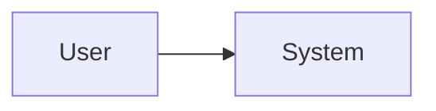

# System Architecture

> Owner: `solution-architect` · Status: TEMPLATE (not yet filled)

## Summary (for the owner)

## Context diagram

## Containers and components

## Deployment view

## Cross-cutting concerns (security, logging, config, observability)

